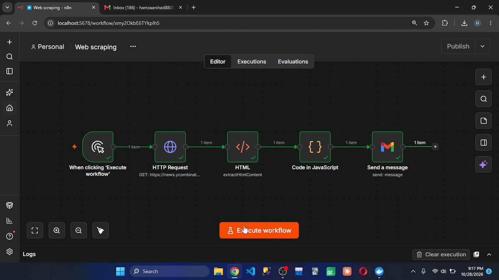

# Automated Top 5 News Email Digest (n8n Workflow)

A production-ready n8n automation pipeline that handles web data extraction, custom JavaScript processing, and automated reporting via email. 

## Workflow Overview
1. **Trigger:** Manual trigger (can be configured to run daily/hourly).
2. **Data Fetching:** Pulls live HTML payloads from the targeted web source.
3. **Data Processing (JavaScript):** Takes the raw extraction array, trims it down to the top 5 updates using optimized data selection arrays, and dynamically inserts HTML line breaks (` `) for layout presentation.
4. **Delivery:** Dispatches a structured single email update using secure Gmail OAuth2 integration.

## Tech Stack
* **n8n** (Workflow Orchestration)
* **JavaScript** (Data Manipulation & Extraction)
* **HTML** (Email Formatting)

## How to Import to Your n8n Instance
1. Download the `Web scraping.json` blueprint file from this repository.
2. Open your n8n workspace dashboard.
3. Create a new workflow, click the top-right menu, and select **Import from file**.
4. Link your own **Gmail account credentials** inside the final email node, and change the `sendTo` parameter to your target inbox address.
